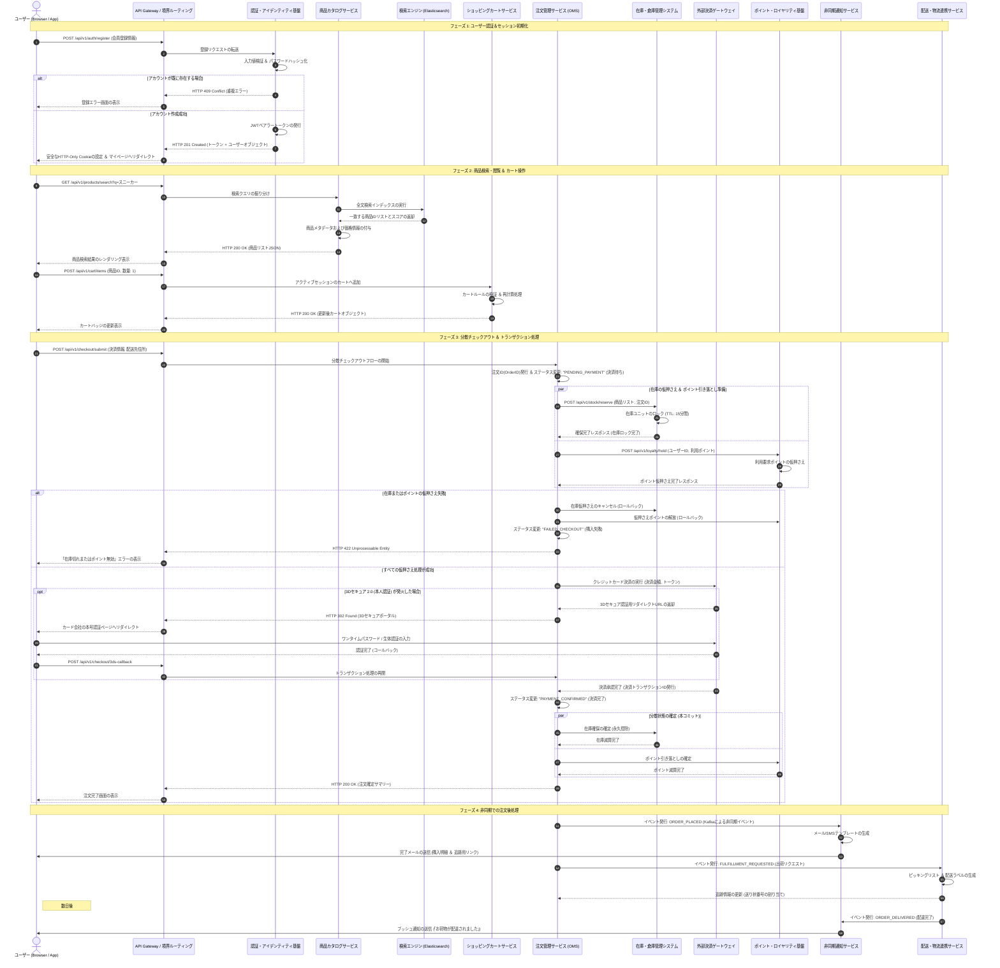
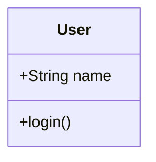
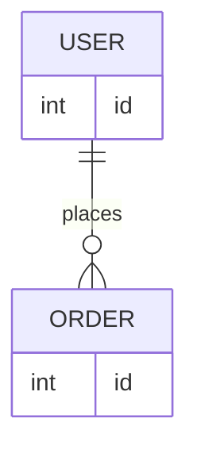
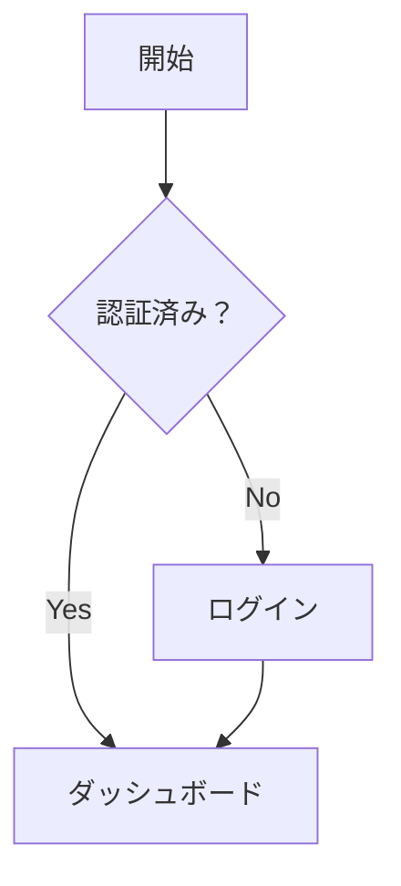
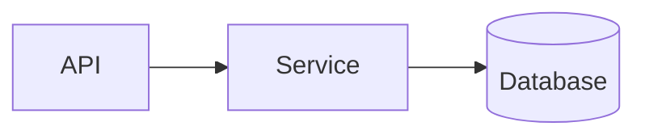
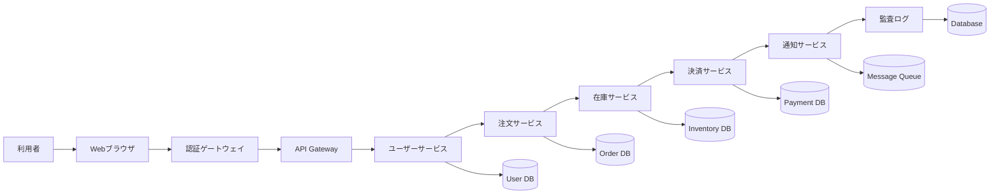
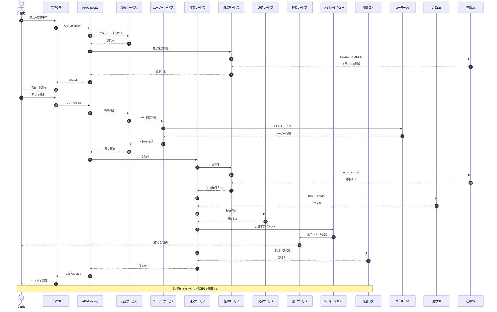
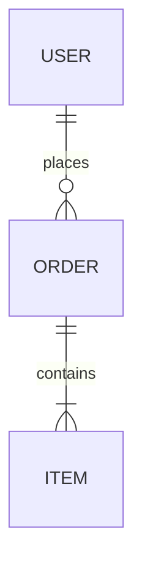
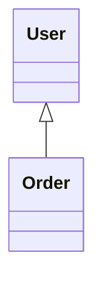

# Markdown 描画・パーサー耐久テストデータ

このファイルは、マークダウンプレビューアーやパーサーが仕様通りに描画できるか、またエッジケース（文字の消失、パース崩れなど）が発生しないかをテストするためのデータです。

## 視覚チェック用クイックリファレンス

以下を目視で確認し、右側の「❌ パース崩れの例」のようになっていないかチェックしてください。

| テスト項目 | ✅ 正しい表示（期待される結果） | ❌ よくあるパース崩れの例 |
| ----- | ----- | ----- |
| **見出し** | 大きな太字テキストとして表示される | 文頭に `#` や `###` が生のまま残る |
| **文中の `#` や `_`** | `C#` や `foo_bar` と記号付きでそのまま表示 | `C` になったり `foo`*`bar`*（斜体）になる |
| **その他の特殊記号** | `a*b*c` や `a~b` が文字のまま表示 | `a`*`b`*`c` になったり波線が消える |
| **括弧やURL** | `[draft]` や `calc(1 + 2)` がそのまま表示 | 文字が消える、リンク化して壊れる |
| **HTML記号** | `a < b && c > d` がそのまま表示 | `< b && c >` 部分がHTMLタグと見なされ消失 |
| **インラインコード** | 背景付きのコード枠で `foo_bar` と表示 | `_` が消えてイタリック化や太字化する |
| **リストのネスト** | 階層ごとにインデント（インデント下げ）される | すべて同じ階層に並んでしまう |
| **エスケープ** | `*星*` や `[リンク]` が記号のまま表示 | 勝手に斜体になったり、リンクになろうとする |

## 1. 基本記法テスト

### 1.1 見出し (Headers)

# H1 見出し

## H2 見出し

### H3 見出し

#### H4 見出し

##### H5 見出し

###### H6 見出し

### 1.2 強調・装飾 (Emphasis)

* アスタリスク単体による斜体: *Italic Text*

* アンダースコア単体による斜体: *Italic Text*

* アスタリスク2つによる太字: **Bold Text**

* アンダースコア2つによる太字: **Bold Text**

* 波線2つによる打ち消し線: ~~Strikethrough Text~~

* 複合装飾: ***Bold and Italic*** / **~~Bold Strikethrough~~**

### 1.3 引用 (Blockquotes)

> これは1段目の引用です。
>
> > これはネストされた引用です。
> >
> > > 3階層目の引用です。
>
> 引用内の複数行改行テスト。

### 1.4 リスト (Lists)

#### 箇条書きリスト

* リスト項目 1
  * ネスト項目 1-1
  * ネスト項目 1-2
    * さらにネスト 1-2-1

* プラステーブル項目 A

* マイナステーブル項目 B

#### 番号付きリスト

1. 項目 1
2. 項目 2
   1. ネストされた番号 2-1
   2. ネストされた番号 2-2
3. 項目 3

#### タスクリスト (Task List)

- [x] 完了したタスク
- [ ] 未完了のタスク
- [ ] `code_block` を含むタスク

### 1.5 コード (Code)

#### インラインコード

これは `inline_code_with_underscores` のテストです。`#1` や `$PATH` も正しく表示されるべきです。

#### フェンス付きコードブロック (Fenced Code Blocks)

```javascript
// JavaScript Test
function testParser(input_string) {
  const hash_count = 10;
  console.log(`Processing #${hash_count}: ${input_string}`);
  return input_string.replace(/_/#g, '');
}
```

```html
<!-- HTML Test -->
<div id="test-container" class="box_style">
  <p>C# & C++ Guide</p>
</div>
```

### 1.6 水平線 (Horizontal Rules)

---

### 1.7 リンク・画像 (Links & Images)

* 通常リンク: [DocBase ヘルプ](https://help.docbase.io/posts/13697)
* 自動リンク: <https://example.com>
* インライン画像: 

### 1.8 テーブル (Tables)

| ID | Name | Category | Status | Price ($) |
| ----- | ----- | ----- | ----- | ----- |
| 001 | Item_A | Category#1 | `active_state` | 1,000 |
| 002 | Item_B_Plus | Category#2 | ~~deprecated~~ | 2,500 |
| 003 | C#_Book | Education | **New** | 500 |

---

### 1.9 アコーディオン

#### 通常のアコーディオン

<details>
  <summary>概要</summary>
  コンテンツ詳細<br>コンテンツ_01<br>コンテンツ_02
</details>

#### 初めから開いている状態のアコーディオン

<details open>
  <summary>概要</summary>
  コンテンツ詳細<br>コンテンツ_01<br>コンテンツ_02
</details>

#### リスト内包のアコーディオン

<details>
  <summary>概要</summary>
  <p>詳細</p>
  <ul>
    <li>リスト①</li>
    <li>リスト②</li>
    <li>リスト③</li>
  </ul>
</details>

#### 入れ子構造のアコーディオン

<details>
  <summary>概要</summary>
  <p>詳細</p>
  <ul>
    <li>リスト①</li>
    <li>リスト②</li>
    <li>リスト③</li>
  </ul>
  <details>
    <summary>入れ子の子①</summary>
    コンテンツ<br>コンテンツ_01<br>コンテンツ_02
  </details>
  <details>
    <summary>入れ子の子②</summary>
    コンテンツ<br>コンテンツ_01<br>コンテンツ_02
    <p>詳細</p>
    <ul>
      <li>リスト①</li>
      <li>リスト②</li>
      <li>リスト③</li>
    </ul>
  </details>
</details>

---

## 2. 意地悪テスト (Edge Cases & Parser Torture)

※パーサーが誤って文字を削ったり、パースエラーを起こさないかを検証する領域です。

### 2.1 文中の `#`（見出し誤判定チェック）

見出し（`#`）は「行頭 + `#` + 半角スペース」が基本です。以下の文脈で `#` が消えたり見出し化しないか確認してください。

* プログラミング言語: C#, F#, J#
* ソーシャルハッシュタグ: #markdown #parser_test
* 文中の記号: Issue #1234 を参照（# の前にスペースあり）
* 行頭だがスペースなし: #HeaderIsNotThis
* 数字直結: #12345

### 2.2 文中の `_`（斜体・太字誤判定チェック）

アンダースコア（`_`）を消し込んだり、勝手に `<i>` タグに変換していないか確認してください。

* スネークケース変数名: `user_first_name`, `get_data_by_id`, `__init__`
* 通常テキスト内のスネークケース: my_variable_name_test
* 連続アンダースコア: variable___name___test
* パスやURL: `/usr/local/var_log_messages/test_file.txt`

### 2.3 アスタリスク `*` / 波線 `~` / バックティック `` ` `` の文中的使用

* 数式・計算式: `2 * 3 * 4 = 24`（アスタリスクが消えて `3` が斜体にならないか）
* チルダ・波線: `~1000円`, `v1.0.0~beta.1`, `http://example.com/~user/`
* パス・ワイルドカード: `*.js` や `temp_*.tmp`
* バックティック単体（コードブロック外）: 1個の ` や 2個の `` が文言ごと消えていないか

### 2.4 角括弧 `[]` / 丸括弧 `()`（リンク・画像誤判定チェック）

* 角括弧単体: `[Draft]`, `[1]`, `Array[index]`, `[TODO]`（リンク化失敗で消えないか）
* 関数・メソッド呼出: `calc(1 + 2)`, `main(args)`
* 連続括弧: `[Notice](Important)`（実在しない見せかけリンク構造）
* 正規表現・配列表現: `[a-z0-9_]`, `[[1, 2], [3, 4]]`

### 2.5 不等号 `<` `>` / アンド `&`（HTMLエンティティ・自動リンク誤判定チェック）

* 比較演算子: `a < b` や `x > y`
* 不等号が混在する文: `1 < 2 && 3 > 2`（`< 2 && 3 >` が非表示タグ扱いされないか）
* XML/HTMLタグ風テキスト: `<component-name>`, `<UserInput>`
* アンド記号: `AT&T`, `R&D`, `Q&A`, `&amp;`（二重エスケープ崩れチェック）

### 2.6 パイプ `|` / プラス `+` / マイナス `-`（テーブル・リスト誤判定チェック）

* 文中のパイプ（テーブル外）: `command1 | command2`, `A || B`
* 行頭以外の記号: `1 + 1 = 2`, `apple - banana - cherry`
* 箇条書き風テキスト: `+1` や `-100` が文頭にあってもリスト化しないか

### 2.7 バックスラッシュ `\` / ドル記号 `$`（LaTeX/数式拡張チェック）

* Windowsパス: `C:\Users\Admin\Documents\file.txt`（`\` が後続文字ごと消失しないか）
* 金額表示: `$100` や `$50`（LaTeX数式モードに入り込んでフォントが変わらないか）
* 複数ドル記号: `Price: $10 or $20`

### 2.8 エスケープ処理 (Escaping)

バックスラッシュ（`\`）によるエスケープが機能し、リテラルとして表示されるか確認してください。

* エスケープされたアスタリスク: \*this is not italic\*
* エスケープされたアンダースコア: \_this is not italic\_
* エスケープされたハッシュ: \# This is not a header
* エスケープされたバックティック: \`not code\`
* エスケープされた波線: \~\~not strikethrough\~\~
* エスケープされたブラケット: \[Not A Link\]\(https://example.com\)

### 2.9 複雑な組み合わせ・ネスト

* **太字の中の `code_with_underscore` テスト**
* *斜体の中の `C#_Language` テスト*
* [リンクテキスト内の `code_in_link`](https://example.com)
* > 引用内での `snake_case_variable` と #hashtag、および `calc(a < b)`

### 2.10 特殊文字・XSS対策

* `<script>alert('XSS Test');</script>` (エスケープされてテキスト表示されるべき)
* `javascript:void(0)` を含むリンク構造: [XSS Link](javascript:alert('XSS'))

---

## 3 表テスト

| テーブルID | テーブル名 (物理名) | 論理名 | 区分 | レコード件数見込み | ステータス | 担当チーム | 最終更新日 | 
 | ----- | ----- | ----- | ----- | ----- | ----- | ----- | ----- | 
| TBL-001 | `t_orders` | 注文ヘッダ | トランザクション | 10,000,000+ | 確定 | 注文チーム | 2026/08/15 | 
| TBL-002 | `m_users` | 会員基本情報 | マスタ | 1,000,000+ | 確定 | ユーザーチーム | 2026/08/10 | 
| TBL-003 | `t_order_items` | 注文明細 | トランザクション | 30,000,000+ | 確定 | 注文チーム | 2026/08/15 | 
| TBL-004 | `m_products` | 商品基本情報 | マスタ | 500,000 | 確定 | 商品チーム | 2026/07/20 | 
| TBL-005 | `t_payments` | 決済履歴 | トランザクション | 12,000,000+ | 確定 | 決済チーム | 2026/08/18 | 
| TBL-006 | `m_payment_methods` | 決済種別マスタ | マスタ | 20 | 確定 | 決済チーム | 2026/05/11 | 
| TBL-007 | `t_shipments` | 出荷指示データ | トランザクション | 8,000,000+ | レビュー中 | 物流チーム | 2026/09/01 | 
| TBL-008 | `m_warehouses` | 倉庫マスタ | マスタ | 50 | 確定 | 物流チーム | 2026/06/15 | 
| TBL-009 | `t_inventory` | 在庫変動履歴 | トランザクション | 50,000,000+ | レビュー中 | 物流チーム | 2026/09/02 | 
| TBL-010 | `m_categories` | 商品カテゴリ | マスタ | 1,500 | 確定 | 商品チーム | 2026/06/01 | 
| TBL-011 | `m_brands` | ブランドマスタ | マスタ | 800 | 確定 | 商品チーム | 2026/06/05 | 
| TBL-012 | `t_coupons` | クーポン発行履歴 | トランザクション | 2,000,000+ | 確定 | 販促チーム | 2026/07/29 | 
| TBL-013 | `m_coupon_templates` | クーポン原券マスタ | マスタ | 300 | 確定 | 販促チーム | 2026/07/25 | 
| TBL-014 | `m_user_ranks` | 会員ランクマスタ | マスタ | 10 | 確定 | ユーザーチーム | 2026/04/01 | 
| TBL-015 | `t_cart` | カート情報 | 一時データ | 500,000 | 確定 | UI/UXチーム | 2026/08/12 | 
| TBL-016 | `t_cart_items` | カート投入商品 | 一時データ | 1,500,000 | 確定 | UI/UXチーム | 2026/08/12 | 
| TBL-017 | `m_suppliers` | 仕入先マスタ | マスタ | 3,000 | 確定 | 調達チーム | 2026/04/10 | 
| TBL-018 | `t_purchase_orders` | 発注データ | トランザクション | 100,000 | 作成中 | 調達チーム | 2026/09/10 | 
| TBL-019 | `m_product_tags` | 商品タグマスタ | マスタ | 5,000 | 確定 | 商品チーム | 2026/06/18 | 
| TBL-020 | `t_returns` | 返品リクエスト | トランザクション | 50,000 | 確定 | CSチーム | 2026/08/01 | 
| TBL-021 | `m_return_reasons` | 返品理由マスタ | マスタ | 15 | 確定 | CSチーム | 2026/03/15 | 
| TBL-022 | `t_reviews` | 商品レビュー | コンテンツ | 3,000,000+ | 確定 | メディアチーム | 2026/07/11 | 
| TBL-023 | `m_review_badges` | レビューバッジマスタ | マスタ | 25 | 作成中 | メディアチーム | 2026/09/08 | 
| TBL-024 | `t_audit_logs` | システム操作ログ | ログ | 100,000,000+ | 確定 | 基盤チーム | 2026/08/30 | 
| TBL-025 | `m_tax_rates` | 税率マスタ | マスタ | 10 | 確定 | 会計チーム | 2026/01/05 | 
| TBL-026 | `m_currencies` | 通貨マスタ | マスタ | 50 | 確定 | 会計チーム | 2026/01/10 | 
| TBL-027 | `t_invoices` | 請求・領収データ | トランザクション | 10,000,000+ | 作成中 | 会計チーム | 2026/09/12 | 
| TBL-028 | `m_shipping_carriers` | 配送業者マスタ | マスタ | 12 | 確定 | 物流チーム | 2026/05/20 | 
| TBL-029 | `m_shipping_rates` | 送料設定マスタ | マスタ | 500 | レビュー中 | 物流チーム | 2026/08/28 | 
| TBL-030 | `t_user_addresses` | 配送先住所録 | マスタ | 2,500,000 | 確定 | ユーザーチーム | 2026/08/05 | 
| TBL-031 | `t_notifications` | ユーザー通知履歴 | トランザクション | 20,000,000+ | 廃止予定 | 基盤チーム | 2026/06/30 | 
| TBL-032 | `m_notification_templates` | 通知テンプレート | マスタ | 150 | 確定 | 基盤チーム | 2026/07/02 | 
| TBL-033 | `m_campaigns` | キャンペーン設定 | マスタ | 200 | 確定 | 販促チーム | 2026/08/22 | 
| TBL-034 | `t_points_history` | ポイント増減履歴 | トランザクション | 40,000,000+ | 確定 | 販促チーム | 2026/08/19 | 
| TBL-035 | `m_point_rules` | ポイント付与条件マスタ | マスタ | 30 | 確定 | 販促チーム | 2026/05/14 | 
| TBL-036 | `t_api_access_logs` | 外部連携ログ | ログ | 500,000,000+ | レビュー中 | 基盤チーム | 2026/09/05 | 
| TBL-037 | `m_system_config` | システム設定値 | システム | 100 | 確定 | 基盤チーム | 2026/02/01 | 
| TBL-038 | `t_temp_registrations` | 仮会員登録 | 一時データ | 10,000 | 確定 | ユーザーチーム | 2026/07/01 | 
| TBL-039 | `m_regions` | 都道府県・地域マスタ | マスタ | 47 | 確定 | 共通チーム | 2025/11/01 | 
| TBL-040 | `m_zip_codes` | 郵便番号マスタ | マスタ | 150,000 | 確定 | 共通チーム | 2026/03/01 | 
| TBL-041 | `m_store_locations` | 実店舗マスタ | マスタ | 120 | レビュー中 | OMOチーム | 2026/08/30 | 
| TBL-042 | `t_store_stock` | 店舗別在庫 | トランザクション | 5,000,000 | 作成中 | OMOチーム | 2026/09/11 | 
| TBL-043 | `m_gift_wrappings` | ギフト包装マスタ | マスタ | 20 | 確定 | 物流チーム | 2026/04/18 | 
| TBL-044 | `t_gift_messages` | ギフトメッセージデータ | トランザクション | 300,000 | 確定 | 注文チーム | 2026/07/15 | 
| TBL-045 | `m_promotions` | プロモーションマスタ | マスタ | 80 | 作成中 | 販促チーム | 2026/09/01 | 
| TBL-046 | `m_vendors` | 委託先事業者マスタ | マスタ | 40 | 確定 | 調達チーム | 2026/02/20 | 
| TBL-047 | `t_vendor_payouts` | 委託先支払データ | トランザクション | 15,000 | レビュー中 | 会計チーム | 2026/09/03 | 
| TBL-048 | `m_blacklists` | 不正ユーザー判定マスタ | マスタ | 1,200 | 確定 | セキュリティ | 2026/08/11 | 
| TBL-049 | `t_security_alerts` | セキュリティ検知ログ | ログ | 2,000,000 | 確定 | セキュリティ | 2026/08/29 | 
| TBL-050 | `m_faq_categories` | FAQカテゴリマスタ | マスタ | 30 | 確定 | CSチーム | 2026/05/01 | 

## 4 Mermaidテスト

### sequence



### Class


### ER


### アコーディオン

<details>
<summary>クリックして詳細を表示</summary>

# 総合テスト

## 1. 表セル内の改行

Markdown表ではセル内に物理的な改行を入れると次の行として扱われるため、<br>一般的なGFMと同様に `<br>` を使います。

| ID | 項目 | 詳細 |
|---:|---|---|
| 1 | 改行1 | 1行目<br>2行目<br>3行目 |
| 2 | 長文+改行 | 設計上の注意点です。<br>入力値を検証してください。<br>エラー時は画面を停止させず通知します。 |
| 3 | 箇条書き風 | ・認証<br>・認可<br>・監査ログ |
| 4 | コード風 | `foo()` を呼び出す<br>戻り値を確認する<br>失敗なら再試行する |

## 2. 先頭列固定テスト

| ID | サービス名 | 担当 | ステータス | 更新日 | 備考 |
|---:|---|---|---|---|---|
| 001 | 認証サービス | Platform | 稼働中 | 2026-09-01 | OAuth / セッション管理を担当 |
| 002 | API Gateway | Platform | 稼働中 | 2026-09-02 | 外部APIへの入口。レート制限あり |
| 003 | 注文サービス | Commerce | 改修中 | 2026-09-03 | トランザクション境界を整理中 |
| 004 | 決済サービス | Commerce | 稼働中 | 2026-09-04 | 決済プロバイダとの接続を管理 |
| 005 | 通知サービス | Communication | 稼働中 | 2026-09-05 | メール・プッシュ通知を非同期送信 |

## 3. 先頭行固定 + 横幅テスト

| ID | 非常に長い列名：ユーザー要求の背景と技術的制約 | 入力仕様 | 出力仕様 | エラー処理 | 備考 |
|---:|---|---|---|---|---|
| 1 | 横幅の広い列を意図的に作っています。列幅変更ハンドルをドラッグしてください。 | UTF-8 / JSON | JSON | エラーコードを返す | 長い文章でも表外へはみ出さないこと |
| 2 | このセルにはかなり長い説明を書いています。文章が長くなった場合にも横スクロールとセル内折り返しが正しく共存することを確認します。 | 文字列 / 数値 / 配列 | 正常系レスポンス | バリデーションエラー | 画面全体の横スクロールは発生しない想定 |
| 3 | 右端のリサイズ領域を使って表全体の幅を変更できます。 | 任意 | 任意 | ログ記録 | 表単位でサイズが保持されます |
| 4 | 表の右下のハンドルでは縦横を同時に変更できます。 | 任意 | 任意 | 通知表示 | 再読み込み後はサイズを保持しません |

## 4. 大量行テスト（80行）

| No. | 名前 | カテゴリ | 状態 | 説明 | 更新 |
|---:|---|---|---|---|---|
| 001 | テスト項目 1 | Category-2 | 完了 | 大量データ時の縦スクロールと先頭行固定を確認するためのサンプル行 1。長いセルの折り返しも確認します。 | 2026-09-02 |
| 002 | テスト項目 2 | Category-3 | 完了 | 大量データ時の縦スクロールと先頭行固定を確認するためのサンプル行 2。長いセルの折り返しも確認します。 | 2026-09-03 |
| 003 | テスト項目 3 | Category-4 | 確認中 | 大量データ時の縦スクロールと先頭行固定を確認するためのサンプル行 3。長いセルの折り返しも確認します。 | 2026-09-04 |
| 004 | テスト項目 4 | Category-5 | 完了 | 大量データ時の縦スクロールと先頭行固定を確認するためのサンプル行 4。長いセルの折り返しも確認します。 | 2026-09-05 |
| 005 | テスト項目 5 | Category-6 | 完了 | 大量データ時の縦スクロールと先頭行固定を確認するためのサンプル行 5。長いセルの折り返しも確認します。 | 2026-09-06 |
| 006 | テスト項目 6 | Category-7 | 確認中 | 大量データ時の縦スクロールと先頭行固定を確認するためのサンプル行 6。長いセルの折り返しも確認します。 | 2026-09-07 |
| 007 | テスト項目 7 | Category-8 | 完了 | 大量データ時の縦スクロールと先頭行固定を確認するためのサンプル行 7。長いセルの折り返しも確認します。 | 2026-09-08 |
| 008 | テスト項目 8 | Category-1 | 完了 | 大量データ時の縦スクロールと先頭行固定を確認するためのサンプル行 8。長いセルの折り返しも確認します。 | 2026-09-09 |
| 009 | テスト項目 9 | Category-2 | 確認中 | 大量データ時の縦スクロールと先頭行固定を確認するためのサンプル行 9。長いセルの折り返しも確認します。 | 2026-09-10 |
| 010 | テスト項目 10 | Category-3 | 完了 | 大量データ時の縦スクロールと先頭行固定を確認するためのサンプル行 10。長いセルの折り返しも確認します。 | 2026-09-11 |
| 011 | テスト項目 11 | Category-4 | 完了 | 大量データ時の縦スクロールと先頭行固定を確認するためのサンプル行 11。長いセルの折り返しも確認します。 | 2026-09-12 |
| 012 | テスト項目 12 | Category-5 | 確認中 | 大量データ時の縦スクロールと先頭行固定を確認するためのサンプル行 12。長いセルの折り返しも確認します。 | 2026-09-13 |
| 013 | テスト項目 13 | Category-6 | 完了 | 大量データ時の縦スクロールと先頭行固定を確認するためのサンプル行 13。長いセルの折り返しも確認します。 | 2026-09-14 |
| 014 | テスト項目 14 | Category-7 | 完了 | 大量データ時の縦スクロールと先頭行固定を確認するためのサンプル行 14。長いセルの折り返しも確認します。 | 2026-09-15 |
| 015 | テスト項目 15 | Category-8 | 確認中 | 大量データ時の縦スクロールと先頭行固定を確認するためのサンプル行 15。長いセルの折り返しも確認します。 | 2026-09-16 |
| 016 | テスト項目 16 | Category-1 | 完了 | 大量データ時の縦スクロールと先頭行固定を確認するためのサンプル行 16。長いセルの折り返しも確認します。 | 2026-09-17 |
| 017 | テスト項目 17 | Category-2 | 完了 | 大量データ時の縦スクロールと先頭行固定を確認するためのサンプル行 17。長いセルの折り返しも確認します。 | 2026-09-18 |
| 018 | テスト項目 18 | Category-3 | 確認中 | 大量データ時の縦スクロールと先頭行固定を確認するためのサンプル行 18。長いセルの折り返しも確認します。 | 2026-09-19 |
| 019 | テスト項目 19 | Category-4 | 完了 | 大量データ時の縦スクロールと先頭行固定を確認するためのサンプル行 19。長いセルの折り返しも確認します。 | 2026-09-20 |
| 020 | テスト項目 20 | Category-5 | 完了 | 大量データ時の縦スクロールと先頭行固定を確認するためのサンプル行 20。長いセルの折り返しも確認します。 | 2026-09-21 |
| 021 | テスト項目 21 | Category-6 | 確認中 | 大量データ時の縦スクロールと先頭行固定を確認するためのサンプル行 21。長いセルの折り返しも確認します。 | 2026-09-22 |
| 022 | テスト項目 22 | Category-7 | 完了 | 大量データ時の縦スクロールと先頭行固定を確認するためのサンプル行 22。長いセルの折り返しも確認します。 | 2026-09-23 |
| 023 | テスト項目 23 | Category-8 | 完了 | 大量データ時の縦スクロールと先頭行固定を確認するためのサンプル行 23。長いセルの折り返しも確認します。 | 2026-09-24 |
| 024 | テスト項目 24 | Category-1 | 確認中 | 大量データ時の縦スクロールと先頭行固定を確認するためのサンプル行 24。長いセルの折り返しも確認します。 | 2026-09-25 |
| 025 | テスト項目 25 | Category-2 | 完了 | 大量データ時の縦スクロールと先頭行固定を確認するためのサンプル行 25。長いセルの折り返しも確認します。 | 2026-09-26 |
| 026 | テスト項目 26 | Category-3 | 完了 | 大量データ時の縦スクロールと先頭行固定を確認するためのサンプル行 26。長いセルの折り返しも確認します。 | 2026-09-27 |
| 027 | テスト項目 27 | Category-4 | 確認中 | 大量データ時の縦スクロールと先頭行固定を確認するためのサンプル行 27。長いセルの折り返しも確認します。 | 2026-09-28 |
| 028 | テスト項目 28 | Category-5 | 完了 | 大量データ時の縦スクロールと先頭行固定を確認するためのサンプル行 28。長いセルの折り返しも確認します。 | 2026-09-01 |
| 029 | テスト項目 29 | Category-6 | 完了 | 大量データ時の縦スクロールと先頭行固定を確認するためのサンプル行 29。長いセルの折り返しも確認します。 | 2026-09-02 |
| 030 | テスト項目 30 | Category-7 | 確認中 | 大量データ時の縦スクロールと先頭行固定を確認するためのサンプル行 30。長いセルの折り返しも確認します。 | 2026-09-03 |
| 031 | テスト項目 31 | Category-8 | 完了 | 大量データ時の縦スクロールと先頭行固定を確認するためのサンプル行 31。長いセルの折り返しも確認します。 | 2026-09-04 |
| 032 | テスト項目 32 | Category-1 | 完了 | 大量データ時の縦スクロールと先頭行固定を確認するためのサンプル行 32。長いセルの折り返しも確認します。 | 2026-09-05 |
| 033 | テスト項目 33 | Category-2 | 確認中 | 大量データ時の縦スクロールと先頭行固定を確認するためのサンプル行 33。長いセルの折り返しも確認します。 | 2026-09-06 |
| 034 | テスト項目 34 | Category-3 | 完了 | 大量データ時の縦スクロールと先頭行固定を確認するためのサンプル行 34。長いセルの折り返しも確認します。 | 2026-09-07 |
| 035 | テスト項目 35 | Category-4 | 完了 | 大量データ時の縦スクロールと先頭行固定を確認するためのサンプル行 35。長いセルの折り返しも確認します。 | 2026-09-08 |
| 036 | テスト項目 36 | Category-5 | 確認中 | 大量データ時の縦スクロールと先頭行固定を確認するためのサンプル行 36。長いセルの折り返しも確認します。 | 2026-09-09 |
| 037 | テスト項目 37 | Category-6 | 完了 | 大量データ時の縦スクロールと先頭行固定を確認するためのサンプル行 37。長いセルの折り返しも確認します。 | 2026-09-10 |
| 038 | テスト項目 38 | Category-7 | 完了 | 大量データ時の縦スクロールと先頭行固定を確認するためのサンプル行 38。長いセルの折り返しも確認します。 | 2026-09-11 |
| 039 | テスト項目 39 | Category-8 | 確認中 | 大量データ時の縦スクロールと先頭行固定を確認するためのサンプル行 39。長いセルの折り返しも確認します。 | 2026-09-12 |
| 040 | テスト項目 40 | Category-1 | 完了 | 大量データ時の縦スクロールと先頭行固定を確認するためのサンプル行 40。長いセルの折り返しも確認します。 | 2026-09-13 |
| 041 | テスト項目 41 | Category-2 | 完了 | 大量データ時の縦スクロールと先頭行固定を確認するためのサンプル行 41。長いセルの折り返しも確認します。 | 2026-09-14 |
| 042 | テスト項目 42 | Category-3 | 確認中 | 大量データ時の縦スクロールと先頭行固定を確認するためのサンプル行 42。長いセルの折り返しも確認します。 | 2026-09-15 |
| 043 | テスト項目 43 | Category-4 | 完了 | 大量データ時の縦スクロールと先頭行固定を確認するためのサンプル行 43。長いセルの折り返しも確認します。 | 2026-09-16 |
| 044 | テスト項目 44 | Category-5 | 完了 | 大量データ時の縦スクロールと先頭行固定を確認するためのサンプル行 44。長いセルの折り返しも確認します。 | 2026-09-17 |
| 045 | テスト項目 45 | Category-6 | 確認中 | 大量データ時の縦スクロールと先頭行固定を確認するためのサンプル行 45。長いセルの折り返しも確認します。 | 2026-09-18 |
| 046 | テスト項目 46 | Category-7 | 完了 | 大量データ時の縦スクロールと先頭行固定を確認するためのサンプル行 46。長いセルの折り返しも確認します。 | 2026-09-19 |
| 047 | テスト項目 47 | Category-8 | 完了 | 大量データ時の縦スクロールと先頭行固定を確認するためのサンプル行 47。長いセルの折り返しも確認します。 | 2026-09-20 |
| 048 | テスト項目 48 | Category-1 | 確認中 | 大量データ時の縦スクロールと先頭行固定を確認するためのサンプル行 48。長いセルの折り返しも確認します。 | 2026-09-21 |
| 049 | テスト項目 49 | Category-2 | 完了 | 大量データ時の縦スクロールと先頭行固定を確認するためのサンプル行 49。長いセルの折り返しも確認します。 | 2026-09-22 |
| 050 | テスト項目 50 | Category-3 | 完了 | 大量データ時の縦スクロールと先頭行固定を確認するためのサンプル行 50。長いセルの折り返しも確認します。 | 2026-09-23 |
| 051 | テスト項目 51 | Category-4 | 確認中 | 大量データ時の縦スクロールと先頭行固定を確認するためのサンプル行 51。長いセルの折り返しも確認します。 | 2026-09-24 |
| 052 | テスト項目 52 | Category-5 | 完了 | 大量データ時の縦スクロールと先頭行固定を確認するためのサンプル行 52。長いセルの折り返しも確認します。 | 2026-09-25 |
| 053 | テスト項目 53 | Category-6 | 完了 | 大量データ時の縦スクロールと先頭行固定を確認するためのサンプル行 53。長いセルの折り返しも確認します。 | 2026-09-26 |
| 054 | テスト項目 54 | Category-7 | 確認中 | 大量データ時の縦スクロールと先頭行固定を確認するためのサンプル行 54。長いセルの折り返しも確認します。 | 2026-09-27 |
| 055 | テスト項目 55 | Category-8 | 完了 | 大量データ時の縦スクロールと先頭行固定を確認するためのサンプル行 55。長いセルの折り返しも確認します。 | 2026-09-28 |
| 056 | テスト項目 56 | Category-1 | 完了 | 大量データ時の縦スクロールと先頭行固定を確認するためのサンプル行 56。長いセルの折り返しも確認します。 | 2026-09-01 |
| 057 | テスト項目 57 | Category-2 | 確認中 | 大量データ時の縦スクロールと先頭行固定を確認するためのサンプル行 57。長いセルの折り返しも確認します。 | 2026-09-02 |
| 058 | テスト項目 58 | Category-3 | 完了 | 大量データ時の縦スクロールと先頭行固定を確認するためのサンプル行 58。長いセルの折り返しも確認します。 | 2026-09-03 |
| 059 | テスト項目 59 | Category-4 | 完了 | 大量データ時の縦スクロールと先頭行固定を確認するためのサンプル行 59。長いセルの折り返しも確認します。 | 2026-09-04 |
| 060 | テスト項目 60 | Category-5 | 確認中 | 大量データ時の縦スクロールと先頭行固定を確認するためのサンプル行 60。長いセルの折り返しも確認します。 | 2026-09-05 |
| 061 | テスト項目 61 | Category-6 | 完了 | 大量データ時の縦スクロールと先頭行固定を確認するためのサンプル行 61。長いセルの折り返しも確認します。 | 2026-09-06 |
| 062 | テスト項目 62 | Category-7 | 完了 | 大量データ時の縦スクロールと先頭行固定を確認するためのサンプル行 62。長いセルの折り返しも確認します。 | 2026-09-07 |
| 063 | テスト項目 63 | Category-8 | 確認中 | 大量データ時の縦スクロールと先頭行固定を確認するためのサンプル行 63。長いセルの折り返しも確認します。 | 2026-09-08 |
| 064 | テスト項目 64 | Category-1 | 完了 | 大量データ時の縦スクロールと先頭行固定を確認するためのサンプル行 64。長いセルの折り返しも確認します。 | 2026-09-09 |
| 065 | テスト項目 65 | Category-2 | 完了 | 大量データ時の縦スクロールと先頭行固定を確認するためのサンプル行 65。長いセルの折り返しも確認します。 | 2026-09-10 |
| 066 | テスト項目 66 | Category-3 | 確認中 | 大量データ時の縦スクロールと先頭行固定を確認するためのサンプル行 66。長いセルの折り返しも確認します。 | 2026-09-11 |
| 067 | テスト項目 67 | Category-4 | 完了 | 大量データ時の縦スクロールと先頭行固定を確認するためのサンプル行 67。長いセルの折り返しも確認します。 | 2026-09-12 |
| 068 | テスト項目 68 | Category-5 | 完了 | 大量データ時の縦スクロールと先頭行固定を確認するためのサンプル行 68。長いセルの折り返しも確認します。 | 2026-09-13 |
| 069 | テスト項目 69 | Category-6 | 確認中 | 大量データ時の縦スクロールと先頭行固定を確認するためのサンプル行 69。長いセルの折り返しも確認します。 | 2026-09-14 |
| 070 | テスト項目 70 | Category-7 | 完了 | 大量データ時の縦スクロールと先頭行固定を確認するためのサンプル行 70。長いセルの折り返しも確認します。 | 2026-09-15 |
| 071 | テスト項目 71 | Category-8 | 完了 | 大量データ時の縦スクロールと先頭行固定を確認するためのサンプル行 71。長いセルの折り返しも確認します。 | 2026-09-16 |
| 072 | テスト項目 72 | Category-1 | 確認中 | 大量データ時の縦スクロールと先頭行固定を確認するためのサンプル行 72。長いセルの折り返しも確認します。 | 2026-09-17 |
| 073 | テスト項目 73 | Category-2 | 完了 | 大量データ時の縦スクロールと先頭行固定を確認するためのサンプル行 73。長いセルの折り返しも確認します。 | 2026-09-18 |
| 074 | テスト項目 74 | Category-3 | 完了 | 大量データ時の縦スクロールと先頭行固定を確認するためのサンプル行 74。長いセルの折り返しも確認します。 | 2026-09-19 |
| 075 | テスト項目 75 | Category-4 | 確認中 | 大量データ時の縦スクロールと先頭行固定を確認するためのサンプル行 75。長いセルの折り返しも確認します。 | 2026-09-20 |
| 076 | テスト項目 76 | Category-5 | 完了 | 大量データ時の縦スクロールと先頭行固定を確認するためのサンプル行 76。長いセルの折り返しも確認します。 | 2026-09-21 |
| 077 | テスト項目 77 | Category-6 | 完了 | 大量データ時の縦スクロールと先頭行固定を確認するためのサンプル行 77。長いセルの折り返しも確認します。 | 2026-09-22 |
| 078 | テスト項目 78 | Category-7 | 確認中 | 大量データ時の縦スクロールと先頭行固定を確認するためのサンプル行 78。長いセルの折り返しも確認します。 | 2026-09-23 |
| 079 | テスト項目 79 | Category-8 | 完了 | 大量データ時の縦スクロールと先頭行固定を確認するためのサンプル行 79。長いセルの折り返しも確認します。 | 2026-09-24 |
| 080 | テスト項目 80 | Category-1 | 完了 | 大量データ時の縦スクロールと先頭行固定を確認するためのサンプル行 80。長いセルの折り返しも確認します。 | 2026-09-25 |

## 5. 両方固定テスト

| ID | A列 | B列 | C列 | D列 | E列 | F列 | G列 | H列 | I列 | J列 |
|---:|---|---|---|---|---|---|---|---|---|---|
| 01 | 左固定 1 | B-1 | C-1 | D-1 | E-1 | F-1 | G-1 | H-1 | I-1 | J-1 |
| 02 | 左固定 2 | B-2 | C-2 | D-2 | E-2 | F-2 | G-2 | H-2 | I-2 | J-2 |
| 03 | 左固定 3 | B-3 | C-3 | D-3 | E-3 | F-3 | G-3 | H-3 | I-3 | J-3 |
| 04 | 左固定 4 | B-4 | C-4 | D-4 | E-4 | F-4 | G-4 | H-4 | I-4 | J-4 |
| 05 | 左固定 5 | B-5 | C-5 | D-5 | E-5 | F-5 | G-5 | H-5 | I-5 | J-5 |
| 06 | 左固定 6 | B-6 | C-6 | D-6 | E-6 | F-6 | G-6 | H-6 | I-6 | J-6 |
| 07 | 左固定 7 | B-7 | C-7 | D-7 | E-7 | F-7 | G-7 | H-7 | I-7 | J-7 |
| 08 | 左固定 8 | B-8 | C-8 | D-8 | E-8 | F-8 | G-8 | H-8 | I-8 | J-8 |
| 09 | 左固定 9 | B-9 | C-9 | D-9 | E-9 | F-9 | G-9 | H-9 | I-9 | J-9 |
| 10 | 左固定 10 | B-10 | C-10 | D-10 | E-10 | F-10 | G-10 | H-10 | I-10 | J-10 |
| 11 | 左固定 11 | B-11 | C-11 | D-11 | E-11 | F-11 | G-11 | H-11 | I-11 | J-11 |
| 12 | 左固定 12 | B-12 | C-12 | D-12 | E-12 | F-12 | G-12 | H-12 | I-12 | J-12 |
| 13 | 左固定 13 | B-13 | C-13 | D-13 | E-13 | F-13 | G-13 | H-13 | I-13 | J-13 |
| 14 | 左固定 14 | B-14 | C-14 | D-14 | E-14 | F-14 | G-14 | H-14 | I-14 | J-14 |
| 15 | 左固定 15 | B-15 | C-15 | D-15 | E-15 | F-15 | G-15 | H-15 | I-15 | J-15 |
| 16 | 左固定 16 | B-16 | C-16 | D-16 | E-16 | F-16 | G-16 | H-16 | I-16 | J-16 |
| 17 | 左固定 17 | B-17 | C-17 | D-17 | E-17 | F-17 | G-17 | H-17 | I-17 | J-17 |
| 18 | 左固定 18 | B-18 | C-18 | D-18 | E-18 | F-18 | G-18 | H-18 | I-18 | J-18 |
| 19 | 左固定 19 | B-19 | C-19 | D-19 | E-19 | F-19 | G-19 | H-19 | I-19 | J-19 |
| 20 | 左固定 20 | B-20 | C-20 | D-20 | E-20 | F-20 | G-20 | H-20 | I-20 | J-20 |
| 21 | 左固定 21 | B-21 | C-21 | D-21 | E-21 | F-21 | G-21 | H-21 | I-21 | J-21 |
| 22 | 左固定 22 | B-22 | C-22 | D-22 | E-22 | F-22 | G-22 | H-22 | I-22 | J-22 |
| 23 | 左固定 23 | B-23 | C-23 | D-23 | E-23 | F-23 | G-23 | H-23 | I-23 | J-23 |
| 24 | 左固定 24 | B-24 | C-24 | D-24 | E-24 | F-24 | G-24 | H-24 | I-24 | J-24 |
| 25 | 左固定 25 | B-25 | C-25 | D-25 | E-25 | F-25 | G-25 | H-25 | I-25 | J-25 |
| 26 | 左固定 26 | B-26 | C-26 | D-26 | E-26 | F-26 | G-26 | H-26 | I-26 | J-26 |
| 27 | 左固定 27 | B-27 | C-27 | D-27 | E-27 | F-27 | G-27 | H-27 | I-27 | J-27 |
| 28 | 左固定 28 | B-28 | C-28 | D-28 | E-28 | F-28 | G-28 | H-28 | I-28 | J-28 |
| 29 | 左固定 29 | B-29 | C-29 | D-29 | E-29 | F-29 | G-29 | H-29 | I-29 | J-29 |
| 30 | 左固定 30 | B-30 | C-30 | D-30 | E-30 | F-30 | G-30 | H-30 | I-30 | J-30 |
| 31 | 左固定 31 | B-31 | C-31 | D-31 | E-31 | F-31 | G-31 | H-31 | I-31 | J-31 |
| 32 | 左固定 32 | B-32 | C-32 | D-32 | E-32 | F-32 | G-32 | H-32 | I-32 | J-32 |
| 33 | 左固定 33 | B-33 | C-33 | D-33 | E-33 | F-33 | G-33 | H-33 | I-33 | J-33 |
| 34 | 左固定 34 | B-34 | C-34 | D-34 | E-34 | F-34 | G-34 | H-34 | I-34 | J-34 |
| 35 | 左固定 35 | B-35 | C-35 | D-35 | E-35 | F-35 | G-35 | H-35 | I-35 | J-35 |
| 36 | 左固定 36 | B-36 | C-36 | D-36 | E-36 | F-36 | G-36 | H-36 | I-36 | J-36 |
| 37 | 左固定 37 | B-37 | C-37 | D-37 | E-37 | F-37 | G-37 | H-37 | I-37 | J-37 |
| 38 | 左固定 38 | B-38 | C-38 | D-38 | E-38 | F-38 | G-38 | H-38 | I-38 | J-38 |
| 39 | 左固定 39 | B-39 | C-39 | D-39 | E-39 | F-39 | G-39 | H-39 | I-39 | J-39 |
| 40 | 左固定 40 | B-40 | C-40 | D-40 | E-40 | F-40 | G-40 | H-40 | I-40 | J-40 |
| 41 | 左固定 41 | B-41 | C-41 | D-41 | E-41 | F-41 | G-41 | H-41 | I-41 | J-41 |
| 42 | 左固定 42 | B-42 | C-42 | D-42 | E-42 | F-42 | G-42 | H-42 | I-42 | J-42 |
| 43 | 左固定 43 | B-43 | C-43 | D-43 | E-43 | F-43 | G-43 | H-43 | I-43 | J-43 |
| 44 | 左固定 44 | B-44 | C-44 | D-44 | E-44 | F-44 | G-44 | H-44 | I-44 | J-44 |
| 45 | 左固定 45 | B-45 | C-45 | D-45 | E-45 | F-45 | G-45 | H-45 | I-45 | J-45 |
| 46 | 左固定 46 | B-46 | C-46 | D-46 | E-46 | F-46 | G-46 | H-46 | I-46 | J-46 |
| 47 | 左固定 47 | B-47 | C-47 | D-47 | E-47 | F-47 | G-47 | H-47 | I-47 | J-47 |
| 48 | 左固定 48 | B-48 | C-48 | D-48 | E-48 | F-48 | G-48 | H-48 | I-48 | J-48 |
| 49 | 左固定 49 | B-49 | C-49 | D-49 | E-49 | F-49 | G-49 | H-49 | I-49 | J-49 |
| 50 | 左固定 50 | B-50 | C-50 | D-50 | E-50 | F-50 | G-50 | H-50 | I-50 | J-50 |

## 6. Markdown要素との組み合わせ

### タスクリスト

- [x] 表を表示する
- [x] 先頭行を固定する
- [ ] 列幅を変更する
- [ ] 表をCSV出力する

### 引用

> 表のスクロールは表内部だけで完結する必要があります。

### コード

```javascript
function resizeTable(width, height) {
  return { width, height };
}
```

### Mermaid


## Flowchart



## Graph



## Wide Flowchart

横方向に長い図。拡大しても横スクロールバーを使わず、図を掴んで移動して確認できます。



## Long Sequence Diagram

横にも縦にも長いシーケンス図。枠をリサイズし、図をドラッグして各部分を確認するテスト用です。



## ER Diagram



## Class Diagram



## State Diagram


</details>


**テスト終了**