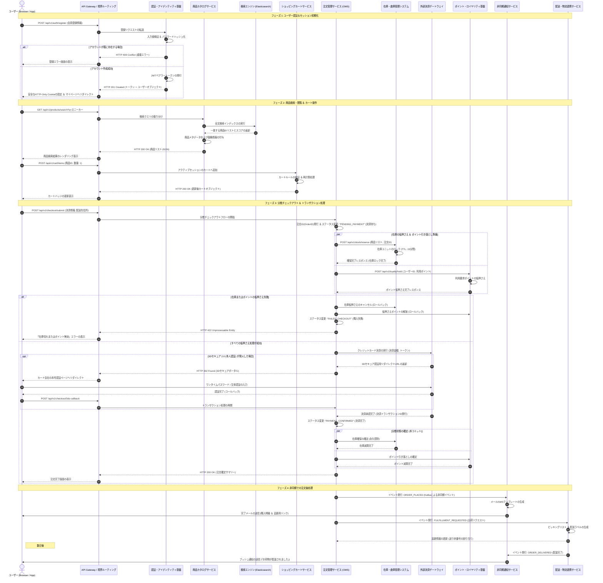
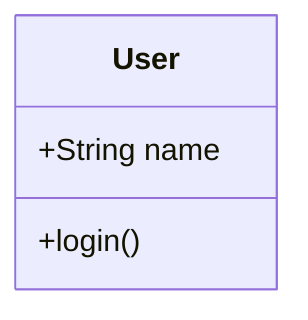
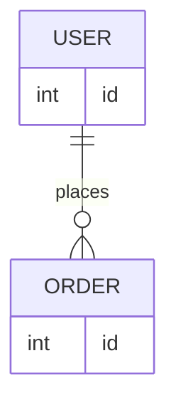

# Markdown 描画・パーサー耐久テストデータ

このファイルは、マークダウンプレビューアーやパーサーが仕様通りに描画できるか、またエッジケース（文字の消失、パース崩れなど）が発生しないかをテストするためのデータです。

## 視覚チェック用クイックリファレンス

以下を目視で確認し、右側の「❌ パース崩れの例」のようになっていないかチェックしてください。

| テスト項目 | ✅ 正しい表示（期待される結果） | ❌ よくあるパース崩れの例 |
| ----- | ----- | ----- |
| **見出し** | 大きな太字テキストとして表示される | 文頭に `#` や `###` が生のまま残る |
| **文中の `#` や `_`** | `C#` や `foo_bar` と記号付きでそのまま表示 | `C` になったり `foo`*`bar`*（斜体）になる |
| **その他の特殊記号** | `a*b*c` や `a~b` が文字のまま表示 | `a`*`b`*`c` になったり波線が消える |
| **括弧やURL** | `[draft]` や `calc(1 + 2)` がそのまま表示 | 文字が消える、リンク化して壊れる |
| **HTML記号** | `a < b && c > d` がそのまま表示 | `< b && c >` 部分がHTMLタグと見なされ消失 |
| **インラインコード** | 背景付きのコード枠で `foo_bar` と表示 | `_` が消えてイタリック化や太字化する |
| **リストのネスト** | 階層ごとにインデント（インデント下げ）される | すべて同じ階層に並んでしまう |
| **エスケープ** | `*星*` や `[リンク]` が記号のまま表示 | 勝手に斜体になったり、リンクになろうとする |

## 1. 基本記法テスト

### 1.1 見出し (Headers)

# H1 見出し

## H2 見出し

### H3 見出し

#### H4 見出し

##### H5 見出し

###### H6 見出し

### 1.2 強調・装飾 (Emphasis)

* アスタリスク単体による斜体: *Italic Text*

* アンダースコア単体による斜体: *Italic Text*

* アスタリスク2つによる太字: **Bold Text**

* アンダースコア2つによる太字: **Bold Text**

* 波線2つによる打ち消し線: ~~Strikethrough Text~~

* 複合装飾: ***Bold and Italic*** / **~~Bold Strikethrough~~**

### 1.3 引用 (Blockquotes)

> これは1段目の引用です。
>
> > これはネストされた引用です。
> >
> > > 3階層目の引用です。
>
> 引用内の複数行改行テスト。

### 1.4 リスト (Lists)

#### 箇条書きリスト

* リスト項目 1
  * ネスト項目 1-1
  * ネスト項目 1-2
    * さらにネスト 1-2-1

* プラステーブル項目 A

* マイナステーブル項目 B

#### 番号付きリスト

1. 項目 1
2. 項目 2
   1. ネストされた番号 2-1
   2. ネストされた番号 2-2
3. 項目 3

#### タスクリスト (Task List)

- [x] 完了したタスク
- [ ] 未完了のタスク
- [ ] `code_block` を含むタスク

### 1.5 コード (Code)

#### インラインコード

これは `inline_code_with_underscores` のテストです。`#1` や `$PATH` も正しく表示されるべきです。

#### フェンス付きコードブロック (Fenced Code Blocks)

```javascript
// JavaScript Test
function testParser(input_string) {
  const hash_count = 10;
  console.log(`Processing #${hash_count}: ${input_string}`);
  return input_string.replace(/_/#g, '');
}
```

```html
<!-- HTML Test -->
<div id="test-container" class="box_style">
  <p>C# & C++ Guide</p>
</div>
```

### 1.6 水平線 (Horizontal Rules)

---

### 1.7 リンク・画像 (Links & Images)

* 通常リンク: [DocBase ヘルプ](https://help.docbase.io/posts/13697)
* 自動リンク: <https://example.com>
* インライン画像: 

### 1.8 テーブル (Tables)

| ID | Name | Category | Status | Price ($) |
| ----- | ----- | ----- | ----- | ----- |
| 001 | Item_A | Category#1 | `active_state` | 1,000 |
| 002 | Item_B_Plus | Category#2 | ~~deprecated~~ | 2,500 |
| 003 | C#_Book | Education | **New** | 500 |

---

## 2. 意地悪テスト (Edge Cases & Parser Torture)

※パーサーが誤って文字を削ったり、パースエラーを起こさないかを検証する領域です。

### 2.1 文中の `#`（見出し誤判定チェック）

見出し（`#`）は「行頭 + `#` + 半角スペース」が基本です。以下の文脈で `#` が消えたり見出し化しないか確認してください。

* プログラミング言語: C#, F#, J#
* ソーシャルハッシュタグ: #markdown #parser_test
* 文中の記号: Issue #1234 を参照（# の前にスペースあり）
* 行頭だがスペースなし: #HeaderIsNotThis
* 数字直結: #12345

### 2.2 文中の `_`（斜体・太字誤判定チェック）

アンダースコア（`_`）を消し込んだり、勝手に `<i>` タグに変換していないか確認してください。

* スネークケース変数名: `user_first_name`, `get_data_by_id`, `__init__`
* 通常テキスト内のスネークケース: my_variable_name_test
* 連続アンダースコア: variable___name___test
* パスやURL: `/usr/local/var_log_messages/test_file.txt`

### 2.3 アスタリスク `*` / 波線 `~` / バックティック `` ` `` の文中的使用

* 数式・計算式: `2 * 3 * 4 = 24`（アスタリスクが消えて `3` が斜体にならないか）
* チルダ・波線: `~1000円`, `v1.0.0~beta.1`, `http://example.com/~user/`
* パス・ワイルドカード: `*.js` や `temp_*.tmp`
* バックティック単体（コードブロック外）: 1個の ` や 2個の `` が文言ごと消えていないか

### 2.4 角括弧 `[]` / 丸括弧 `()`（リンク・画像誤判定チェック）

* 角括弧単体: `[Draft]`, `[1]`, `Array[index]`, `[TODO]`（リンク化失敗で消えないか）
* 関数・メソッド呼出: `calc(1 + 2)`, `main(args)`
* 連続括弧: `[Notice](Important)`（実在しない見せかけリンク構造）
* 正規表現・配列表現: `[a-z0-9_]`, `[[1, 2], [3, 4]]`

### 2.5 不等号 `<` `>` / アンド `&`（HTMLエンティティ・自動リンク誤判定チェック）

* 比較演算子: `a < b` や `x > y`
* 不等号が混在する文: `1 < 2 && 3 > 2`（`< 2 && 3 >` が非表示タグ扱いされないか）
* XML/HTMLタグ風テキスト: `<component-name>`, `<UserInput>`
* アンド記号: `AT&T`, `R&D`, `Q&A`, `&amp;`（二重エスケープ崩れチェック）

### 2.6 パイプ `|` / プラス `+` / マイナス `-`（テーブル・リスト誤判定チェック）

* 文中のパイプ（テーブル外）: `command1 | command2`, `A || B`
* 行頭以外の記号: `1 + 1 = 2`, `apple - banana - cherry`
* 箇条書き風テキスト: `+1` や `-100` が文頭にあってもリスト化しないか

### 2.7 バックスラッシュ `\` / ドル記号 `$`（LaTeX/数式拡張チェック）

* Windowsパス: `C:\Users\Admin\Documents\file.txt`（`\` が後続文字ごと消失しないか）
* 金額表示: `$100` や `$50`（LaTeX数式モードに入り込んでフォントが変わらないか）
* 複数ドル記号: `Price: $10 or $20`

### 2.8 エスケープ処理 (Escaping)

バックスラッシュ（`\`）によるエスケープが機能し、リテラルとして表示されるか確認してください。

* エスケープされたアスタリスク: \*this is not italic\*
* エスケープされたアンダースコア: \_this is not italic\_
* エスケープされたハッシュ: \# This is not a header
* エスケープされたバックティック: \`not code\`
* エスケープされた波線: \~\~not strikethrough\~\~
* エスケープされたブラケット: \[Not A Link\]\(https://example.com\)

### 2.9 複雑な組み合わせ・ネスト

* **太字の中の `code_with_underscore` テスト**
* *斜体の中の `C#_Language` テスト*
* [リンクテキスト内の `code_in_link`](https://example.com)
* > 引用内での `snake_case_variable` と #hashtag、および `calc(a < b)`

### 2.10 特殊文字・XSS対策

* `<script>alert('XSS Test');</script>` (エスケープされてテキスト表示されるべき)
* `javascript:void(0)` を含むリンク構造: [XSS Link](javascript:alert('XSS'))

---

## 3 表テスト

| テーブルID | テーブル名 (物理名) | 論理名 | 区分 | レコード件数見込み | ステータス | 担当チーム | 最終更新日 | 
 | ----- | ----- | ----- | ----- | ----- | ----- | ----- | ----- | 
| TBL-001 | `t_orders` | 注文ヘッダ | トランザクション | 10,000,000+ | 確定 | 注文チーム | 2026/08/15 | 
| TBL-002 | `m_users` | 会員基本情報 | マスタ | 1,000,000+ | 確定 | ユーザーチーム | 2026/08/10 | 
| TBL-003 | `t_order_items` | 注文明細 | トランザクション | 30,000,000+ | 確定 | 注文チーム | 2026/08/15 | 
| TBL-004 | `m_products` | 商品基本情報 | マスタ | 500,000 | 確定 | 商品チーム | 2026/07/20 | 
| TBL-005 | `t_payments` | 決済履歴 | トランザクション | 12,000,000+ | 確定 | 決済チーム | 2026/08/18 | 
| TBL-006 | `m_payment_methods` | 決済種別マスタ | マスタ | 20 | 確定 | 決済チーム | 2026/05/11 | 
| TBL-007 | `t_shipments` | 出荷指示データ | トランザクション | 8,000,000+ | レビュー中 | 物流チーム | 2026/09/01 | 
| TBL-008 | `m_warehouses` | 倉庫マスタ | マスタ | 50 | 確定 | 物流チーム | 2026/06/15 | 
| TBL-009 | `t_inventory` | 在庫変動履歴 | トランザクション | 50,000,000+ | レビュー中 | 物流チーム | 2026/09/02 | 
| TBL-010 | `m_categories` | 商品カテゴリ | マスタ | 1,500 | 確定 | 商品チーム | 2026/06/01 | 
| TBL-011 | `m_brands` | ブランドマスタ | マスタ | 800 | 確定 | 商品チーム | 2026/06/05 | 
| TBL-012 | `t_coupons` | クーポン発行履歴 | トランザクション | 2,000,000+ | 確定 | 販促チーム | 2026/07/29 | 
| TBL-013 | `m_coupon_templates` | クーポン原券マスタ | マスタ | 300 | 確定 | 販促チーム | 2026/07/25 | 
| TBL-014 | `m_user_ranks` | 会員ランクマスタ | マスタ | 10 | 確定 | ユーザーチーム | 2026/04/01 | 
| TBL-015 | `t_cart` | カート情報 | 一時データ | 500,000 | 確定 | UI/UXチーム | 2026/08/12 | 
| TBL-016 | `t_cart_items` | カート投入商品 | 一時データ | 1,500,000 | 確定 | UI/UXチーム | 2026/08/12 | 
| TBL-017 | `m_suppliers` | 仕入先マスタ | マスタ | 3,000 | 確定 | 調達チーム | 2026/04/10 | 
| TBL-018 | `t_purchase_orders` | 発注データ | トランザクション | 100,000 | 作成中 | 調達チーム | 2026/09/10 | 
| TBL-019 | `m_product_tags` | 商品タグマスタ | マスタ | 5,000 | 確定 | 商品チーム | 2026/06/18 | 
| TBL-020 | `t_returns` | 返品リクエスト | トランザクション | 50,000 | 確定 | CSチーム | 2026/08/01 | 
| TBL-021 | `m_return_reasons` | 返品理由マスタ | マスタ | 15 | 確定 | CSチーム | 2026/03/15 | 
| TBL-022 | `t_reviews` | 商品レビュー | コンテンツ | 3,000,000+ | 確定 | メディアチーム | 2026/07/11 | 
| TBL-023 | `m_review_badges` | レビューバッジマスタ | マスタ | 25 | 作成中 | メディアチーム | 2026/09/08 | 
| TBL-024 | `t_audit_logs` | システム操作ログ | ログ | 100,000,000+ | 確定 | 基盤チーム | 2026/08/30 | 
| TBL-025 | `m_tax_rates` | 税率マスタ | マスタ | 10 | 確定 | 会計チーム | 2026/01/05 | 
| TBL-026 | `m_currencies` | 通貨マスタ | マスタ | 50 | 確定 | 会計チーム | 2026/01/10 | 
| TBL-027 | `t_invoices` | 請求・領収データ | トランザクション | 10,000,000+ | 作成中 | 会計チーム | 2026/09/12 | 
| TBL-028 | `m_shipping_carriers` | 配送業者マスタ | マスタ | 12 | 確定 | 物流チーム | 2026/05/20 | 
| TBL-029 | `m_shipping_rates` | 送料設定マスタ | マスタ | 500 | レビュー中 | 物流チーム | 2026/08/28 | 
| TBL-030 | `t_user_addresses` | 配送先住所録 | マスタ | 2,500,000 | 確定 | ユーザーチーム | 2026/08/05 | 
| TBL-031 | `t_notifications` | ユーザー通知履歴 | トランザクション | 20,000,000+ | 廃止予定 | 基盤チーム | 2026/06/30 | 
| TBL-032 | `m_notification_templates` | 通知テンプレート | マスタ | 150 | 確定 | 基盤チーム | 2026/07/02 | 
| TBL-033 | `m_campaigns` | キャンペーン設定 | マスタ | 200 | 確定 | 販促チーム | 2026/08/22 | 
| TBL-034 | `t_points_history` | ポイント増減履歴 | トランザクション | 40,000,000+ | 確定 | 販促チーム | 2026/08/19 | 
| TBL-035 | `m_point_rules` | ポイント付与条件マスタ | マスタ | 30 | 確定 | 販促チーム | 2026/05/14 | 
| TBL-036 | `t_api_access_logs` | 外部連携ログ | ログ | 500,000,000+ | レビュー中 | 基盤チーム | 2026/09/05 | 
| TBL-037 | `m_system_config` | システム設定値 | システム | 100 | 確定 | 基盤チーム | 2026/02/01 | 
| TBL-038 | `t_temp_registrations` | 仮会員登録 | 一時データ | 10,000 | 確定 | ユーザーチーム | 2026/07/01 | 
| TBL-039 | `m_regions` | 都道府県・地域マスタ | マスタ | 47 | 確定 | 共通チーム | 2025/11/01 | 
| TBL-040 | `m_zip_codes` | 郵便番号マスタ | マスタ | 150,000 | 確定 | 共通チーム | 2026/03/01 | 
| TBL-041 | `m_store_locations` | 実店舗マスタ | マスタ | 120 | レビュー中 | OMOチーム | 2026/08/30 | 
| TBL-042 | `t_store_stock` | 店舗別在庫 | トランザクション | 5,000,000 | 作成中 | OMOチーム | 2026/09/11 | 
| TBL-043 | `m_gift_wrappings` | ギフト包装マスタ | マスタ | 20 | 確定 | 物流チーム | 2026/04/18 | 
| TBL-044 | `t_gift_messages` | ギフトメッセージデータ | トランザクション | 300,000 | 確定 | 注文チーム | 2026/07/15 | 
| TBL-045 | `m_promotions` | プロモーションマスタ | マスタ | 80 | 作成中 | 販促チーム | 2026/09/01 | 
| TBL-046 | `m_vendors` | 委託先事業者マスタ | マスタ | 40 | 確定 | 調達チーム | 2026/02/20 | 
| TBL-047 | `t_vendor_payouts` | 委託先支払データ | トランザクション | 15,000 | レビュー中 | 会計チーム | 2026/09/03 | 
| TBL-048 | `m_blacklists` | 不正ユーザー判定マスタ | マスタ | 1,200 | 確定 | セキュリティ | 2026/08/11 | 
| TBL-049 | `t_security_alerts` | セキュリティ検知ログ | ログ | 2,000,000 | 確定 | セキュリティ | 2026/08/29 | 
| TBL-050 | `m_faq_categories` | FAQカテゴリマスタ | マスタ | 30 | 確定 | CSチーム | 2026/05/01 | 

## 4 Mermaidテスト

### sequence



### Class


### ER



**テスト終了**