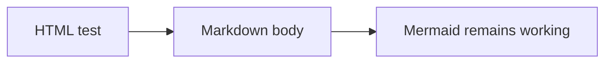

# HTML埋め込み・拡張Markdown確認用テスト

このファイルは、HTMLタグとMarkdownの混在表示、および既存機能への影響を確認するためのテストデータです。

## 1. details / summary（基本）

<details>
<summary>クリックして詳細を表示</summary>

ここは **Markdownの太字** です。

- リスト項目A
- リスト項目B

`inline_code()` も表示されます。

| 項目 | 値 |
| --- | --- |
| 商品ID | `Item_A` |
| 状態 | `active_state` |

```js
const item_id = "t_order_items";
console.log(item_id);
```

</details>

## 2. 最初から開いた details

<details open>
<summary>open属性の確認</summary>

最初から展開されていれば成功です。

改行後の **強調** も確認してください。
</details>

## 3. HTMLインライン要素

キーボードは <kbd>Ctrl</kbd> + <kbd>F</kbd>、水は H<sub>2</sub>O、二乗は x<sup>2</sup> です。

これは <mark>マークされたテキスト</mark> です。これは <abbr title="HyperText Markup Language">HTML</abbr> の略語です。

<div class="example-box">
<p>HTMLの <strong>ブロック要素</strong> も通常どおり表示されるべきです。</p>
<p>識別子 <code>order_item_id</code> のアンダースコアが消えないこと。</p>
</div>

## 4. リンクと危険なHTMLの安全性

通常のリンク：[OpenAI](https://openai.com/)

次の要素は実行されず、危険なスクリプトやイベント属性が除去されることを確認してください。

<script>document.body.dataset.xssExecuted = "true";</script>


<a href="javascript:alert('XSS')" onclick="alert('XSS')">危険なリンク（クリックしない）</a>

## 5. HTML記法を含むコード（HTMLとして実行されないこと）

```html
<details>
  <summary>これはコード例</summary>
  <script>alert('not executed')</script>
</details>
```

## 6. 既存機能の回帰確認

| ID | テーブル名 | 主キー | 状態 |
| --- | --- | --- | --- |
| 1 | `t_order_items` | `order_item_id` | `active_state` |
| 2 | `m_products` | `product_id` | `Item_B_Plus` |



## 7. 確認チェックリスト

- [ ] detailsをクリックして開閉できる
- [ ] details内部の太字・リスト・表・コードブロックがMarkdownとして表示される
- [ ] `<details open>` は初期状態で開いている
- [ ] kbd、sub、sup、mark、abbr が表示される
- [ ] スクリプトが実行されない
- [ ] `onerror` / `onclick` が実行されない
- [ ] `t_order_items`、`order_item_id`、`active_state` の文字が変化しない
- [ ] 表の既存ツールバー、ソート、絞り込み、CSVが動作する
- [ ] Mermaid図が表示される
- [ ] コードブロックの装飾が維持される
